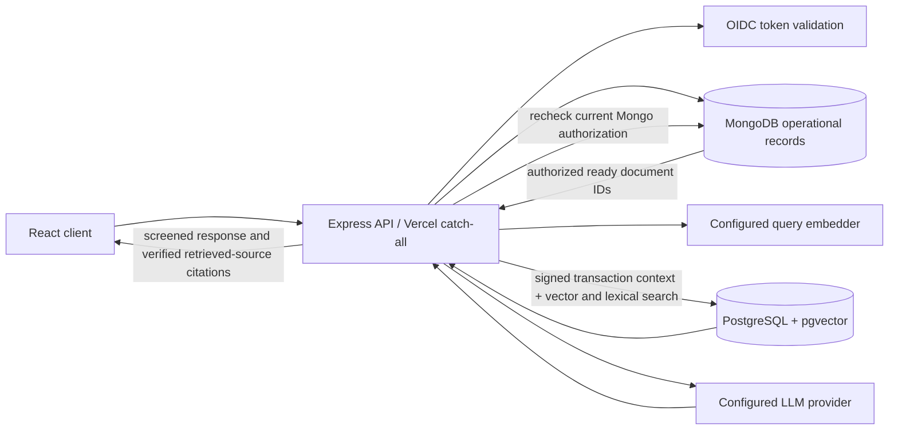

# Current Architecture and Requirements Audit

**Audit date:** 2026-11-15

**Architecture baseline:** React + Node.js; MongoDB Atlas is the operational source of truth; PostgreSQL + pgvector is the RAG retrieval database. This follows the supplied governance update. It does not imply live deployment or service verification.

## Runtime components

- **Frontend:** React application under `src/`, built by Vite. Chat, history, topic selection, and escalation-summary preparation are client-side views.
- **HTTP backend:** Express routes in `server/app.ts`. The Vercel catch-all in `api/[...path].ts` lazily initializes the app and shares one initialization promise per warm instance.
- **Identity:** OIDC JWT/JWKS validation and role/tenant claim mapping in `server/auth.ts`. Protected routes require a verified principal; document management additionally checks the `knowledge_manager` role.
- **Operational records:** MongoDB collections for conversations, messages, documents, ingestion jobs, audit events, and support metadata are initialized by `server/mongodb.ts`.
- **Retrieval:** PostgreSQL `knowledge.document_chunks` with pgvector embeddings, metadata, and full-text search. `server/database.ts` queries only document IDs authorized by MongoDB, applies transaction-local signed RLS context, fuses vector and lexical ranks, and rechecks authorization after retrieval.
- **Stable document identity:** The document ID is created once for the MongoDB document record and is reused as PostgreSQL `document_id`; chunk IDs use that document ID plus the chunk index. MongoDB remains authoritative for ownership, permissions, status, and lifecycle.
- **Ingestion:** `server/document-ingestion.ts` validates, scans, extracts, chunks, embeds, writes document/job state to MongoDB, writes chunks to PostgreSQL, and reconciles cross-database partial failures. The service uses idempotent document identity, recovery jobs, missing/orphan detection, and deletion propagation; cross-database writes do not use distributed transactions.
- **AI providers:** provider and embedding selection are configurable. Model adapters and output/citation filtering live in `server/ai-provider.ts`, `server/gemini.ts`, `server/embeddings.ts`, and `server/rag.ts`.
- **Deployment shape:** `vercel.json` routes `api/[...path].ts` as a 60-second function and includes `knowledge.yaml` and `docs/**`. The Vercel project root must be the directory containing `package.json`, `api/`, and `src/`. The actual Vercel project, build/runtime bundle, environment scopes, and streaming proxy have not been verified.

## Data ownership and retrieval flow

MongoDB is authoritative for document status, ownership, tenant, permission, and conversation records. PostgreSQL stores retrieval chunks and embeddings. A PostgreSQL result is eligible for model context only after server-side Mongo authorization and a second authorization check. RLS is an additional tenant boundary for vector rows; migration 004 has not been applied to a real database, so current database enforcement remains unverified. Do not treat source code or a passing mock as proof of the live database policy.

## Current route surface

| Route | Current behavior / guard |
|---|---|
| `GET /api/models` | Lists configured provider models; authentication required when staging/Preview policy requires it |
| `GET /api/health` | Returns app/dependency status and basic capability metadata |
| `GET /api/conversations` | Requires principal; returns the current owner's, tenant-scoped, non-archived conversations |
| `GET /api/conversations/:conversationId/messages` | Requires principal and scopes both conversation and messages by owner and tenant |
| `POST /api/documents` | Requires authenticated `knowledge_manager`; validates input and delegates scanner/ingestion |
| `GET /api/documents/:documentId` | Requires principal; document service scopes status to owner/tenant or manager policy |
| `DELETE /api/documents/:documentId` | Requires `knowledge_manager`; marks/deletes and propagates deletion to retrieval storage |
| `POST /api/chat` | Validates message/history/attachment; staging policy can require OIDC; performs guidance/retrieval/provider response and persists authenticated turns |
| `POST /api/chat/stream` | Same chat boundary with SSE; buffers and reviews output before exposing it; local tests cover timeout/disconnect behavior |

Escalation submission/review and meeting request/review APIs exist in this checkout. Feedback submission, document version/deactivation, conversation archival/deletion, and retention administration remain absent.

Meeting requests are stored in MongoDB with an initial `pending` state. An authorized HR route can confirm only after explicit actual start/end/timezone details are supplied; the server records actor, timestamp, and `hr_manual` source in the record and audit event. A request is never treated as confirmed on creation. There is no approved calendar adapter, provider, or external call. The UI must continue to reflect only the persisted state.

## Product workflow findings

The detailed FR/NFR/UC/AC mappings and workflow audit are in [the traceability matrix](REQUIREMENTS_TRACEABILITY_MATRIX.md). The current implementation supports chat, local UpToSkills knowledge guidance, authenticated Mongo conversation persistence, role-gated document ingestion/deletion/status, PostgreSQL RAG retrieval, basic source citation generation, insufficient-evidence fallback, health checks, persistent HR escalation, and a persistent meeting request/HR review workflow. Feedback submission, document versioning/deactivation, and a retention scheduler remain absent. Browser authentication and live database integrations are not verified.

## Security and operational boundaries

- OIDC identity/role/tenant data must be server-verified; client-provided role or tenant attributes are not an authority.
- PostgreSQL runtime reader and writer connections are intended to be separate from the migration identity. Migration 004 uses HMAC-signed, five-minute transaction-local context and a private database key table. The Node application process and its HMAC key remain trusted; a compromised app host can mint contexts. Contexts are replayable during their validity window but preserve their signed tenant/global claims.
- PostgreSQL superusers, `BYPASSRLS`, migration roles, and relevant object owners are privileged trust roots. Static SQL review does not establish deployed role configuration.
- Ingestion fails closed when the scanner is unavailable. Parser worker resource limits are not an OS/container sandbox.
- Logs are structured and avoid prompt/document content in normal event fields; source-level tests do not prove production log sinks, access control, or retention settings.
- Provider retention/privacy settings, backups/restores, scanner efficacy, real OIDC issuer configuration, Redis shared limits, and production Vercel behavior have not been verified.

## Workstreams and dependencies

P0 owns the requirements baseline and cross-team decisions. P1 frontend workflow changes use the P2 API/state contracts. P3 document lifecycle features depend on P5 storage/reconciliation semantics. P4 RAG depends on P3-approved source lifecycle and P5 roles/migrations. P6 escalation and SRS P7 meeting request/review code exist, while reviewer/destination policy and privacy/retention decisions remain open. A calendar provider is not needed for the internal request/review code and remains unconfigured pending approval. P8 acceptance coverage still needs isolated live services and browser verification. Full mapping is in the traceability matrix.

## Baseline gaps and release status

The authoritative Phase 6 SRS baseline has been transcribed into `docs/SRS_UPTOSKILLS_AI_SUPPORT_ASSISTANT.md`; all 50 FR/NFR/UC/acceptance items are mapped in the traceability matrix, and stakeholder approval plus D-01–D-10 outcomes remain open. PostgreSQL migration 004, real database role grants, actual pgvector, OIDC, scanner, provider, and Vercel Preview remain unverified. Production readiness is **NOT READY** pending decisions and live integration evidence.
